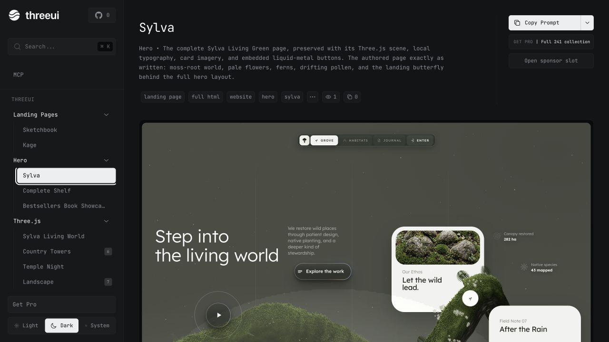

# fe

Bộ sưu tập component **Three.js / WebGL** tương tác cho React: hero section, background shader, landing page template… mỗi component đều có biến thể (variants), bảng điều khiển tham số và tab xem mã nguồn.

Dự án được làm lại từ [ThreeUI Community](https://github.com/MengTo/threeui) của Meng To (giấy phép MIT).



## Những gì đã thay đổi so với bản gốc

- Đổi thương hiệu thành **fe** (logo, tiêu đề trang, SEO, footer, liên kết GitHub).
- Gỡ Google Analytics của tác giả gốc khỏi `index.html`.
- Gỡ phần quảng cáo "Get Pro", khối Sponsor và các liên kết pricing / affiliate.
- Gỡ bộ công cụ đồng bộ với repo riêng của ThreeUI, CLI tải bản Pro và workflow publish npm.
- Rút gọn CI chỉ còn bước build.

## Chạy local

Yêu cầu Node.js 20+.

```bash
npm install
npm run dev
```

Mở http://localhost:5173.

## Build

```bash
npm run build      # typecheck + build site vào dist/
npm run preview    # xem thử bản build
npm run build:lib  # build thư viện React vào lib-dist/
```

## Cấu trúc thư mục

```
src/
  App.tsx            # shell ứng dụng, điều hướng
  components/        # sidebar, footer, trang tài liệu, picker biến thể…
  shaders/           # mã nguồn từng component Three.js / WebGL
  data/              # catalog component
  package-components # entry cho thư viện React
public/              # scene HTML, landing page, source-code.json
scripts/             # script build thư viện
```

## Giấy phép

MIT — xem [LICENSE](LICENSE). Bản quyền gốc thuộc Meng To / ThreeUI, được giữ nguyên theo yêu cầu của giấy phép MIT.

Font đi kèm dùng SIL Open Font License 1.1 ([FONT-LICENSES.md](FONT-LICENSES.md)); runtime Three.js đi kèm dùng MIT. Ảnh thumbnail và video preview trong catalog được tải từ `https://threeui.com` và không thuộc phạm vi giấy phép của repo này — xem [ASSET-LICENSES.md](ASSET-LICENSES.md) và [THIRD_PARTY_NOTICES.md](THIRD_PARTY_NOTICES.md).
